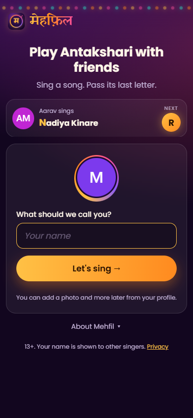
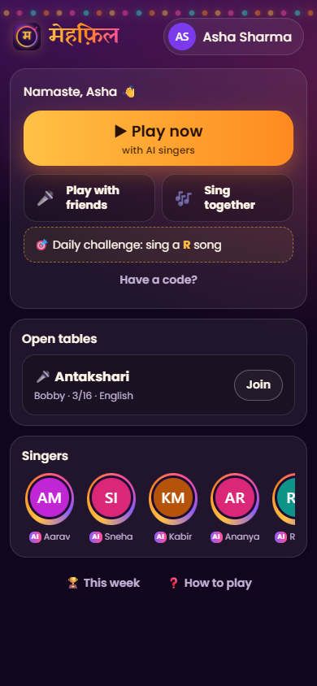
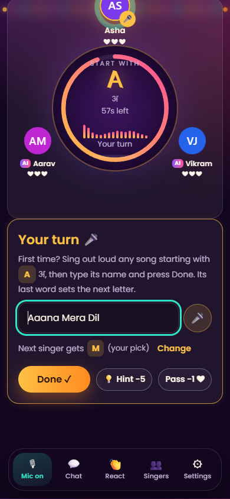
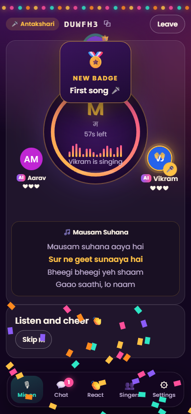
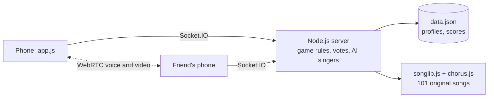

# मेहफ़िल Mehfil: Antakshari online, with friends or AI singers

**Live:** https://mehfil-antakshari.onrender.com · free, no download, works on any phone or computer

Antakshari is India's favourite singing game: you sing a song that starts with the last letter of the song before.
Mehfil puts it online. Send a link on WhatsApp and your friends join with one tap, talk and sing like a phone call,
vote on each other's songs and chat. Nobody free? Press **Play now** and sing with AI singers who answer with their
own songs, lyrics lighting up line by line.

<table>
  <tr>
    <td></td>
    <td></td>
    <td></td>
    <td></td>
  </tr>
  <tr>
    <td align="center">First visit: just a name</td>
    <td align="center">Home: one big Play now</td>
    <td align="center">Your turn</td>
    <td align="center">AI singer, karaoke lyrics</td>
  </tr>
</table>

## What it does

- **Play in seconds.** First visit asks only for a name. Play now starts a game with AI singers at once.
- **Play with friends.** Share a table link on WhatsApp (or a QR code in the same room). Everyone talks like a call, and can turn on video at link-only tables (WebRTC).
- **Fair and fun.** The table votes on every song. Lives, points, a fast-answer bonus, hints, teams, themes (90s, actor, tune), Hindi and Marathi letters.
- **AI singers.** 20 singers with their own voices sing 101 original songs (verse and chorus), clearly marked AI. Easy, Normal or Hard.
- **Your turn is easy.** Type or say the song name; the next letter is worked out for you, or pick any letter A to Z.
- **Rewards.** Points pop-ups, badges, a daily challenge letter, day streaks, a weekly leaderboard and a shareable result picture.
- **Safe by default.** Link-only tables, mute one person, block and report, and a bad-word filter that leaves real names alone.
- **Fast and installable.** First screen in under a second on 4G, opens from a saved copy, works offline, installs like an app.

What changed and when: [CHANGELOG.md](CHANGELOG.md). How it works inside, and the hard problems solved: [docs/HOW-IT-WORKS.md](docs/HOW-IT-WORKS.md).

## Built with

| Part | What |
|------|------|
| Server | Node.js, Express, Socket.IO (real-time game state), compression, qrcode |
| Voice and video | WebRTC peer-to-peer audio and video between players, STUN/TURN for mobile data |
| Browser app | Plain JavaScript, HTML and CSS (no framework), Web Audio, Web Speech (AI voices and "say the song"), Canvas (result picture), View Transitions |
| App features | Service worker (instant reopen and offline), web app manifest (install on phones) |
| Tests | 78 server acceptance checks (`npm test`), 107 end-to-end checks in headless Chrome with Puppeteer (`npm run e2e`), including a two-person video call |



## Run it on your computer

```bash
npm install
npm start          # http://localhost:5090 (and https on your Wi-Fi address, port 5443, for phones)
npm test           # 78 server checks
npm run e2e        # end-to-end checks in headless Chrome (start the server first)
```

## Put it online (free)

1. Push this repo to GitHub.
2. On render.com, create a **Web Service** from it; `render.yaml` has the build and start commands.
3. For voices on mobile data, add your own TURN relay and set `ICE_SERVERS` to its JSON.

## Honest limits

- AI singers **speak** their lyrics with the device's own voices; real sung audio needs a paid singing service.
- The free host sleeps after 15 minutes without visitors (the next visit waits about 30 seconds) and resets saved profiles on restart.
- Voice on mobile data uses a free public relay; a launch needs its own.

## Files

- `server.js`: lobby, tables, game rules, votes, AI singers, invites, safety, persistence.
- `songlib.js`, `chorus.js`: the 101 original songs. `bots.js`: the 20 AI singers.
- `public/`: the web app (`index.html`, `app.js`, `app.css`), service worker, manifest, icons.
- `tests/flow-test.js`: server checks. `tests/e2e/`: browser checks.
- `scripts/`: make the icons and the link-preview picture.
